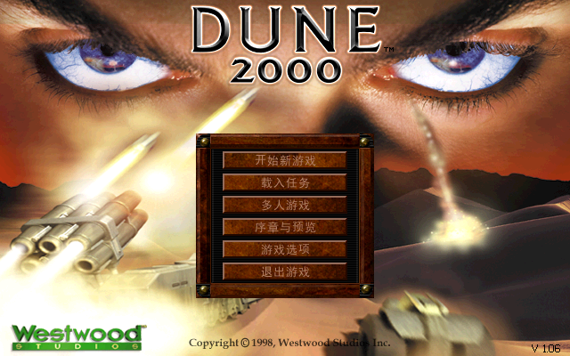
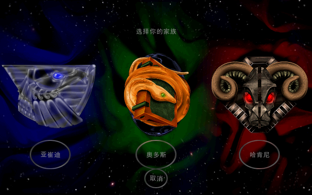
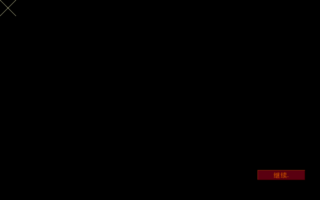
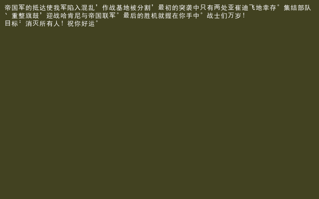
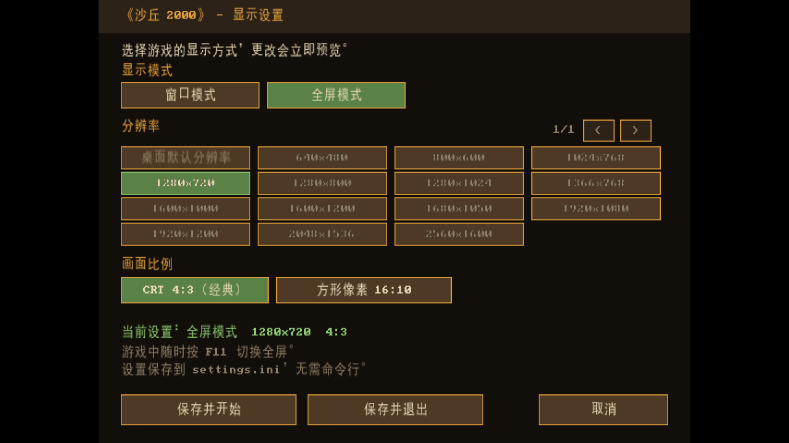

# d2k-faithful

A faithful, open-source reimplementation of **Dune 2000** (Westwood Studios
and Intelligent Games, 1998) for modern Windows and Linux. It plays the 1.06
US game exactly as it was: the same intro, menus, briefings, missions,
rules, AI and quirks, rebuilt from the original program, on the files from
your own CD.

This project contains **no game data**. You need your own copy of Dune 2000.

| | |
|---|---|
|  |  |
|  |  |
|  |  |

*Screenshots of d2k-faithful running on the original game files. The
artwork belongs to its owners; the images are hosted with the release,
not in this repository.*

## Status

**1.0.0 is the single-player release.**

| | |
|---|---|
| Campaigns | Atreides, Harkonnen and Ordos, every mission, briefing, movie and ending |
| Skirmish | Practice games against up to five computer players |
| Front end | The original menus, options, music and sound |
| Saving | Save and load, as the original |
| Multiplayer | Built and working, **not yet tested between real PCs** (see below) |
| Platforms | Windows 10 / 11 (played on); Linux 64-bit (built and tested automatically, not yet played on a Linux desktop) |

Not in 1.0.0: macOS, widescreen views, a map editor. The original's bugs
are kept on purpose.

## Why this project exists

Dune 2000 still runs today only with help: DirectDraw wrappers, compatibility
settings, unofficial patches and installers, and its network play depends on
DirectPlay, which modern Windows no longer ships enabled. Each layer works
for most people most of the time, and none of them is the game as it was.

The goal here is simple: **double-click it, and it is the game you played in
1998.** One program, your own game files, nothing installed in the system,
nothing changed.

## How it differs from other projects

- **The original program is the reference.** Every number, timing, menu,
  transition and AI decision was read out of the 1.06 executable (with
  Ghidra) and written down before it was coded. About sixty findings notes
  in [`docs/re/`](docs/re/) give the function addresses for each system;
  [`docs/parity.md`](docs/parity.md) tracks every system against the
  original with its evidence. Screens were compared pixel for pixel with
  captures of the original game.
- **No rebalancing.** Projects such as the OpenRA Dune 2000 mod rebuild the
  game in another engine and change its rules and interface for modern
  play. Here unit stats, economy, AI and even known bugs are the original's.
  Display options exist (4:3 CRT stretch or square pixels, mouse capture)
  but never show more of the map than the original did, since visible area
  is part of the gameplay.
- **Not a patched original.** Community editions keep the 1998 program and
  wrap or patch it. This is a new program, so it needs no compatibility
  modes, no DirectDraw wrapper, no DirectPlay and no administrator rights.
- **Your own data, checked.** The setup reads your CD, ISO or installed
  folder plus the official 1.06 patch, checks every file against the
  1.06 originals, and keeps its own copy. No game files are in this
  repository or its releases.

## Multiplayer and DirectPlay

The original game connected players through **DirectPlay 4** (IPX or
TCP/IP on a LAN, modem and serial cable) and through Westwood's own internet
lobby. Today IPX is gone from Windows, DirectPlay is a legacy feature that
must be enabled by hand, and the Westwood servers closed long ago.

d2k-faithful keeps everything the game itself decides: the lockstep
simulation, the order delay, the sync check, the lobby screens, chat, and
the rule that the lowest remaining player takes over when the host leaves.
Only the transport underneath is new:

- one player hosts, the others join **from the list of games found on the
  LAN** or **by IP address** (one added box on the LAN lobby screen);
- it uses **UDP port 1998**; all traffic goes through the host, no server
  is involved;
- over the internet the host needs UDP 1998 forwarded, or everyone can join
  the same virtual LAN (Tailscale, ZeroTier and similar) and use its
  addresses;
- the Internet, Modem and Serial buttons are hidden, as the original does
  when those services are not available;
- every player needs the **same build** of d2k-faithful; it does not play
  against the original Dune 2000.

**Status:** multiplayer has been played between two copies on one PC and
with Windows Sandbox, but not yet between separate PCs. Please report
anything that goes wrong.

## Getting started

You need:

- **Your Dune 2000 US CD**, as a disc, an ISO image of it, or an installed
  Dune 2000 folder;
- **the official 1.06 US patch**, `d2k106us.exe` (Westwood's free update
  from 1998), unless your installed folder is already 1.06;
- Windows 10 or 11 (64-bit), or a 64-bit Linux from 2022 or later
  (glibc 2.35+, X11 or Wayland, PipeWire, PulseAudio or ALSA sound).

Then:

1. Download `d2k-faithful-1.0.0-windows-x64.zip` (or the Linux
   `.tar.gz`) from the [releases page](https://github.com/Kyubey64/d2k-faithful/releases)
   and unpack it anywhere.
2. Start `d2k.exe` (Linux: `./d2k`). The program is not signed, so Windows
   may show a SmartScreen warning: choose *More info*, then *Run anyway*.
3. The first start opens a setup screen: **Add CD image**, **Add CD drive
   or folder** (also for an installed game) and **Add patch**. An ISO or
   patch lying next to the program is found by itself.
4. When all 1,305 game files are found, press **Install**. Every file is
   checked against the 1.06 originals and copied once (about 600 MB). The
   CD, the ISO and the patch are not needed afterwards.

The game then starts with the original intro.

### Where things are kept

| | Windows | Linux |
|---|---|---|
| Game data, settings, saves | `%APPDATA%\d2k-faithful\d2k\` | `~/.local/share/d2k-faithful/d2k/` |

`settings.ini` holds the in-game options plus a few of ours. Delete the
`gamedata` folder there to run the setup again.

### Display setup (no command line needed)

Double-click **`显示设置.bat`** next to `d2k.exe` to open a graphical wizard where
you pick display mode (windowed/fullscreen), a resolution and the aspect ratio
with the mouse. Choices are previewed live; **Save & Start** saves and plays,
**Save & Quit** only saves. The same screen opens with `--display-setup`.
During play, **F11** toggles fullscreen at any time.

The wizard lists the resolutions your monitor actually supports (plus a
"Desktop default" entry) and windowed mode also uses the chosen size. The
640×400 picture is letterboxed, so any size works. Everything is saved to
`settings.ini`; nothing on the command line is required.

### Options

The following are alternatives for scripting/automation; the wizard above is
the easy way to set the display options.

| Command line | `settings.ini` | Effect |
|---|---|---|
| `--aspect crt` / `--aspect square` | `aspect=` | The 640×400 picture stretched to 4:3 as on a 1998 monitor (default), or square pixels with integer scaling |
| `--grab 1` / `--grab 0` | `mouse_grab=` | Keep the mouse inside the window |
| `--fullscreen` / `--windowed` | `fullscreen=` | Run fullscreen or windowed; **F11** toggles at runtime (off by default) |
| `--resolution WxH` / `--resolution desktop` | `display_width=` / `display_height=` | The fullscreen resolution: `WxH` picks the closest mode the monitor supports, `desktop` (the default) keeps the desktop's own one. The 640×400 picture is letterboxed at any size |
| `--speed 0..100` | `game_speed=` | The game speed slider |
| `--reset-intro` | `play_full_intro=1` | Play the full first-launch intro again |
| `--data DIR` | | Use a ready 1.06 game folder instead of the game's own copy |
| `--enhanced-movies 1` | `enhanced_movies=` | Show upscaled movie pictures you made yourself from your own movies (Windows; off by default; see [`docs/enhanced-movies.md`](docs/enhanced-movies.md)) |
| `--lang zh-cn` | `lang=` | Optional localisation pack in `i18n/<lang>/` (off by default; see [`I18N.md`](I18N.md)) |
| `--display-setup` | | Open the graphical display setup wizard (same as `显示设置.bat`) |

These change only how the game is shown. Nothing alters the rules, and the
visible map area is the original's.

### Localisation

An optional, **off-by-default** layer can show the UI, unit names, objectives and
campaign briefings in other languages without touching the hash-checked 1.06
data files. Enable it with `--lang zh-cn` (or `lang=zh-cn` in `settings.ini`);
without that, the game stays in English. The build copies `i18n/` next to the
executable automatically.

The bundled `i18n/zh-cn/` pack was generated from a real 1.06 `text.uib`: 940
translations covering every localisable display string (the ones still in English
are proper names, internal mission ids and version numbers). It also covers the
first-run setup wizard, the graphical display setup wizard and dynamically
assembled lobby text. Long briefings and unit descriptions are translated too,
with CJK-aware line wrapping.

Regenerate from your own copy with
`python tools/make_by_key.py` followed by
`python tools/build_i18n.py --uib <your TEXT.UIB>`. Preview without launching:
`d2k-tool ui-render <gamedir> MAINMENU out.png --lang zh-cn` for a menu, or
`d2k-tool text-preview <gamedir> AM1Text2 out.png --lang zh-cn` for a briefing.
See [`I18N.md`](I18N.md) for the pack format, font licensing notes and the
remaining limitations.

**Simplified Chinese screenshots** (rendered from real 1.06 game files):

| | | |
|---|---|---|
|  |  |  |
|  |  |  |

*The underlying game artwork belongs to its owners; these images only show
this project's localisation layer.*

### Known, deliberate differences

- The game runs on a fixed 60 Hz loop. The original was paced by the
  monitor's refresh; its game speed (ticks per second) is reproduced
  exactly.
- Arithmetic uses standard 32-bit floats on every PC, so all players
  compute the same game. The original's 1998 x87 precision is not
  emulated, which can very rarely change a last digit.

## Building from source

Windows: Visual Studio 2019 or later (C++ workload) and CMake 3.24+.

```
cmake -S . -B build -A x64
cmake --build build --config Release
build/bin/Release/d2k_tests.exe
cd build && cpack -G ZIP -C Release
```

Linux: the build environment is `tools/ci/linux.Dockerfile` (Ubuntu
22.04, GCC 12; the package list there also works natively):

```
docker build -t d2k-linux -f tools/ci/linux.Dockerfile tools/ci
docker run --rm -v "$PWD:/src:ro" -v "$PWD/build:/build" d2k-linux
```

SDL3 and doctest are fetched from source at pinned versions. Tests that
need the game data look for it in `gamedata/1.06` and skip themselves
without it. How the original works, function by function, is in
`docs/re/`; progress is tracked in `docs/parity.md`; what the project
taught us is in `docs/lessons-learned.md`.

The project was developed with the help of Claude Code, an AI coding
assistant; `CLAUDE.md` holds the working rules it followed.

## Acknowledgements

The localisation approach — leave the original files untouched, keep
translations external, and draw CJK text with a self-rendered bitmap font —
was informed by [`ChenKe404/SUN_I18N`](https://github.com/ChenKe404/SUN_I18N),
an internationalisation patch for *Command & Conquer: Tiberian Sun* 2.03.
It demonstrated a complete solution to the same class of problems this game
has (single-byte code pages, fixed-size strings, text baked into sprites):
external loading, original-text lookup and substitution, self-drawn CJK fonts,
and a separate asset repository. SUN_I18N's hooks are bound to the TS 2.03
binary and cannot be ported directly; this project is an independent
implementation on top of the open-source d2k-faithful reimplementation and
contains none of its code. Its translation/font asset repo is
[`SUN_I18N_Assets`](https://github.com/ChenKe404/SUN_I18N_Assets).

Terminology also follows common community usage; the OpenRA Dune 2000
Simplified Chinese localisation served as one reference. The Chinese font
bundled in the official Windows release package is generated from
**Noto Sans SC** (SIL OFL 1.1).

## Legal

d2k-faithful is free software under the GNU General Public License v3.0
(`LICENSE`). It uses SDL3 under the zlib license (`LICENSE-SDL3.txt` in the release
packages).
It is not affiliated with or endorsed by Electronic Arts, Westwood Studios
or Intelligent Games. Dune 2000 and its content belong to their owners;
this project ships none of it.
