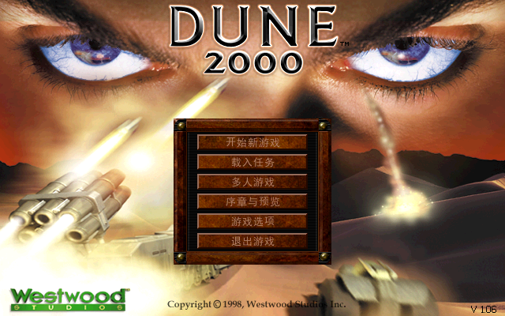
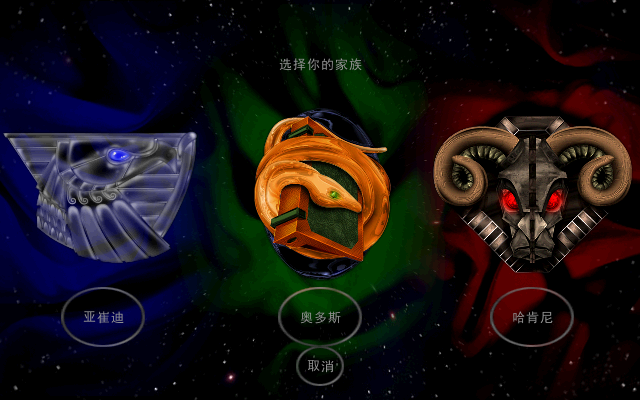
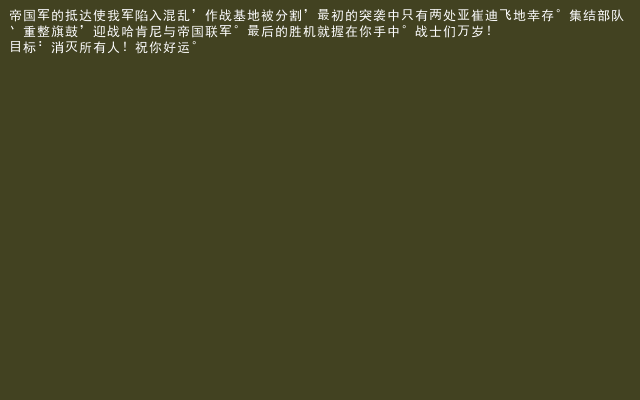
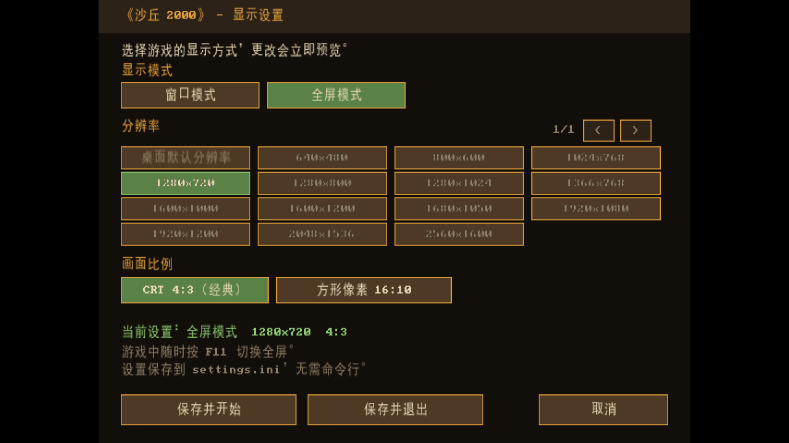

# d2k-faithful 简体中文版

[](LICENSE)
[](README.en.md)

本项目是 [`Kyubey64/d2k-faithful`](https://github.com/Kyubey64/d2k-faithful) 的**简体中文汉化分支**。
d2k-faithful 是用 C++20 / SDL3 从零重写的《沙丘 2000》（Dune 2000，Westwood Studios
与 Intelligent Games，1998）开源复刻，在现代 Windows 和 Linux 上精确重现 1.06 美版的
开场动画、菜单、简报、任务、规则、AI 乃至各种原版"特性"，全部基于你自己的正版游戏数据运行。

**本分支增加了简体中文支持**：一套默认关闭、可一键启用的外置语言包，覆盖菜单界面、单位名称、
任务目标、战役简报、首次安装向导、显示设置向导、建造栏和工具栏提示等，**不改动任何经过
哈希校验的 1.06 原版数据文件**。详见 [`I18N.md`](I18N.md)。

> **本仓库不含任何游戏数据**。你需要自己持有《沙丘 2000》正版。

## 汉化效果预览

| | | |
|---|---|---|
|  |  |  |
|  |  |  |

*以上截图由真实 1.06 游戏文件渲染。底层游戏美术归其权利人所有，图片仅展示本项目的汉化层。*

## 项目状态

**1.0.0 为单人游戏版本。**

| 功能 | 状态 |
|---|---|
| 战役 | 亚崔迪、哈肯尼、奥多斯三族全部任务、简报、过场与结局 |
| 遭遇战 | 对抗最多五个电脑玩家的练习局 |
| 前端界面 | 原版菜单、选项、音乐与音效（含简体中文） |
| 存档 | 与原版一致的保存与读取 |
| 多人游戏 | 已实现并可运行，**尚未在真实的不同电脑间测试**（见下文） |
| 平台 | Windows 10 / 11（已实际游玩）；Linux 64 位（自动构建与测试，尚未在Linux桌面实际游玩） |

1.0.0 不含：macOS、宽屏视野、地图编辑器。原版的 bug 被有意保留。

## 为什么有这个项目

《沙丘 2000》如今要运行起来，得靠一堆外围手段：DirectDraw 包装层、兼容性设置、非官方补丁和安装器；
联机还依赖现代 Windows 默认不启用的 DirectPlay。这些方案大多时候能用，但没有一个是"当年那个游戏"本身。

这里的目标很简单：**双击即玩，就是 1998 年你玩的那个游戏。** 一个程序，用你自己的游戏文件，
不往系统里装任何东西，也不改动任何东西。

## 与其他项目的区别

- **以原版程序为基准。** 每个数值、时序、菜单、切换动画和 AI 决策，都先用 Ghidra 从 1.06 可执行文件
  中读出并记录，再据此编码。[`docs/re/`](docs/re/) 下约六十篇逆向笔记给出每个系统的函数地址；
  [`docs/parity.md`](docs/parity.md) 逐系统对照原版并记录证据。画面与原版逐像素比对。
- **不做平衡性改动。** OpenRA 的沙丘 2000 模组在别的引擎里重建游戏，为现代玩法改变了规则和界面。
  这里单位属性、经济、AI 甚至已知 bug 全部保持原版。显示选项（4:3 CRT 拉伸或方形像素、鼠标捕获）
  存在，但绝不比原版显示更多地图区域，因为可见范围本身就是玩法的一部分。
- **不是打补丁的原版。** 社区版本保留 1998 年的程序并包装或修改它。这是一个全新程序，因此不需要
  兼容模式、DirectDraw 包装层、DirectPlay 或管理员权限。
- **用你自己的数据，且经过校验。** 安装程序读取你的 CD、ISO 或已安装目录，加上官方 1.06 补丁，
  把每个文件与 1.06 原件核对，然后保留自己的一份副本。本仓库及其 release 中不含任何游戏文件。

## 多人游戏与 DirectPlay

原版通过 **DirectPlay 4**（局域网 IPX 或 TCP/IP、调制解调器、串口线）以及 Westwood 自己的互联网大厅
连接玩家。如今 IPX 已从 Windows 移除，DirectPlay 是需手动启用的遗留功能，Westwood 服务器也早已关闭。

d2k-faithful 保留了游戏自身决定的一切：锁步模拟、指令延迟、同步校验、大厅界面、聊天，以及房主离开时
由剩余最低序号玩家接管的规则。只有底层传输是新的：

- 一人建主机，其他人**从局域网游戏列表**或**按 IP 地址**加入（局域网大厅界面新增的输入框）；
- 使用 **UDP 1998 端口**；所有流量经主机中转，无需服务器；
- 互联网游玩时主机需转发 UDP 1998，或所有人加入同一虚拟局域网（Tailscale、ZeroTier 等）并用其地址；
- Internet、Modem、Serial 按钮被隐藏，正如原版在这些服务不可用时所做的那样；
- 每位玩家都需要**相同构建版本**的 d2k-faithful，无法与原版《沙丘 2000》对战。

**状态：** 多人游戏已在同一台电脑上的两个副本之间、以及 Windows 沙盒中测试过，但尚未在不同实体电脑间
测试。遇到任何问题请报告。

## 快速开始

你需要：

- **《沙丘 2000》美版 CD**（光盘、ISO 镜像，或已安装的游戏目录）；
- **官方 1.06 美版补丁** `d2k106us.exe`（Westwood 1998 年的免费更新），除非你的安装目录已是 1.06；
- Windows 10 或 11（64 位），或 2022 年之后的 64 位 Linux（glibc 2.35+、X11 或 Wayland、
  PipeWire/PulseAudio/ALSA 音频）。

然后：

1. 从 [release 页面](https://github.com/cyanjiang/d2k-faithful-zh-cn/releases) 下载本分支的
   Windows 或 Linux 构建包并解压到任意位置（若本分支尚无构建包，可从
   [上游 releases](https://github.com/Kyubey64/d2k-faithful/releases) 下载后自行替换源码构建）。
2. 运行 `d2k.exe`（Linux：`./d2k`）。程序未签名，Windows 可能弹出 SmartScreen 警告：
   选择 *更多信息*，再点 *仍要运行*。
3. 首次启动会打开安装向导：**添加 CD 镜像**、**添加 CD 驱动器或目录**（也适用于已安装游戏）、
   **添加补丁**。放在程序旁的 ISO 或补丁会被自动发现。
4. 找齐全部 1,305 个游戏文件后点 **安装**。每个文件都会与 1.06 原件核对并复制一次（约 600 MB）。
   之后就不再需要 CD、ISO 和补丁。

随后游戏会以原版开场动画启动。

### 文件存放位置

| | Windows | Linux |
|---|---|---|
| 游戏数据、设置、存档 | `%APPDATA%\d2k-faithful\d2k\` | `~/.local/share/d2k-faithful/d2k/` |

`settings.ini` 保存游戏内选项以及本项目的附加选项。删除其中的 `gamedata` 目录可重新运行安装向导。

### 显示设置（无需命令行）

双击 `d2k.exe` 旁边的 **`显示设置.bat`**，即可打开图形向导，用鼠标选择显示模式（窗口/全屏）、
分辨率和画面比例。选择会实时预览；**保存并开始** 保存并进入游戏，**保存并退出** 只保存设置。
命令行 `--display-setup` 也可打开同一界面。游戏进行中随时按 **F11** 切换全屏。

向导会列出显示器实际支持的所有分辨率（外加"桌面默认分辨率"），窗口模式也采用所选尺寸。
640×400 的画面会按比例留黑边，因此任意尺寸都能正常显示。所有设置写入 `settings.ini`，
完全不需要敲命令行。

### 命令行选项

以下为脚本/自动化用途的替代方式，普通用户用上面的图形向导即可。

| 命令行 | `settings.ini` | 作用 |
|---|---|---|
| `--aspect crt` / `--aspect square` | `aspect=` | 640×400 画面按 1998 年显示器拉伸为 4:3（默认），或以方形像素整数缩放 |
| `--grab 1` / `--grab 0` | `mouse_grab=` | 把鼠标限制在窗口内 |
| `--fullscreen` / `--windowed` | `fullscreen=` | 全屏或窗口运行；**F11** 可运行时切换（默认关闭） |
| `--resolution WxH` / `--resolution desktop` | `display_width=` / `display_height=` | 全屏分辨率：`WxH` 选显示器最接近的模式，`desktop`（默认）沿用桌面分辨率 |
| `--speed 0..100` | `game_speed=` | 游戏速度滑块 |
| `--reset-intro` | `play_full_intro=1` | 重新播放完整的首次开场动画 |
| `--data DIR` | | 使用现成的 1.06 游戏目录，而非程序自己的副本 |
| `--enhanced-movies 1` | `enhanced_movies=` | 显示由你自己的影片制作的增强画面（Windows；默认关闭；见 [`docs/enhanced-movies.md`](docs/enhanced-movies.md)） |
| `--lang zh-cn` | `lang=` | 启用 `i18n/<lang>/` 中的可选语言包（默认关闭；见 [`I18N.md`](I18N.md)） |
| `--display-setup` | | 打开图形显示设置向导（同 `显示设置.bat`） |

这些选项只改变游戏的呈现方式，不影响规则，可见地图区域始终与原版一致。

## 简体中文本地化

本分支的中文层**默认关闭**，可在不触碰经过哈希校验的 1.06 数据的前提下，用中文显示界面、
单位名称、任务目标与战役简报。通过 `--lang zh-cn`（或在 `settings.ini` 中设置 `lang=zh-cn`）启用；
不启用则保持英文。构建时会自动把 `i18n/` 复制到可执行文件同级目录。

随附的 `i18n/zh-cn/` 语言包由真实 1.06 的 `text.uib` 生成，含 **940 条译文**，覆盖所有可本地化的
显示文本（仍为英文的是专有名词、内部任务标识和版本号）。它还覆盖首次安装向导、图形显示设置向导、
联机大厅动态拼接文本、建造栏与工具栏提示。长篇简报和单位描述同样已翻译，并采用针对中文的换行处理。

你可以从自己的游戏副本重新生成：先运行 `python tools/make_by_key.py`，再运行
`python tools/build_i18n.py --uib <你的 TEXT.UIB>`。不启动游戏也能预览：
`d2k-tool ui-render <gamedir> MAINMENU out.png --lang zh-cn` 预览菜单，
`d2k-tool text-preview <gamedir> AM1Text2 out.png --lang zh-cn` 预览简报。
语言包格式、字体许可说明和现存限制见 [`I18N.md`](I18N.md)。

### 已知的有意差异

- 游戏以固定 60 Hz 循环运行。原版由显示器刷新率驱动，其游戏速度（每秒 tick 数）被精确复现。
- 所有 PC 使用标准 32 位浮点运算，保证联机各方计算一致；不模拟 1998 年 x87 的精度，
  这极少数情况下可能改变最后一位小数。

## 从源码构建

Windows：Visual Studio 2019 或更高版本（C++ 工作负载）与 CMake 3.24+。

```
cmake -S . -B build -A x64
cmake --build build --config Release
build/bin/Release/d2k_tests.exe
cd build && cpack -G ZIP -C Release
```

若本机没有 "Developer Command Prompt"，可使用 `bash tools/rebuild.sh d2k` 快速增量构建
（脚本会自行设置 MSVC 环境变量）。

Linux：构建环境见 `tools/ci/linux.Dockerfile`（Ubuntu 22.04、GCC 12；其中的软件包列表也可原生使用）：

```
docker build -t d2k-linux -f tools/ci/linux.Dockerfile tools/ci
docker run --rm -v "$PWD:/src:ro" -v "$PWD/build:/build" d2k-linux
```

SDL3 和 doctest 以固定版本从源码获取。需要游戏数据的测试会在 `gamedata/1.06` 中查找，
找不到则自行跳过。原版各系统如何工作见 [`docs/re/`](docs/re/)，进度见 [`docs/parity.md`](docs/parity.md)，
项目经验总结见 [`docs/lessons-learned.md`](docs/lessons-learned.md)。

本项目在开发过程中使用了 AI 编程助手 Claude Code；[`CLAUDE.md`](CLAUDE.md) 记录了其遵循的工作规范。

## 参考与致谢

汉化路线（不改原版文件 + 外置译文 + 自绘点阵中文字库）参考了
[`ChenKe404/SUN_I18N`](https://github.com/ChenKe404/SUN_I18N)——针对《命令与征服：泰伯利亚之日》
2.03 的国际化补丁。它验证了"外挂加载、原文查表替换、自绘中文字库、译文资源分仓"的完整解法，
与本作面临的老引擎单字节码表、定长字符串、贴图文字等难题高度相似，是本分支最重要的架构参考。
SUN_I18N 的实现绑定 TS 2.03 二进制、无法直接移植；本项目是在开源重实现 d2k-faithful 上的独立实现，
未复制其代码。其译文/字库资源仓见 [`SUN_I18N_Assets`](https://github.com/ChenKe404/SUN_I18N_Assets)。

此外，术语译名参考了社区通行译法；相关项目如 OpenRA 的《沙丘 2000》简体中文本地化亦提供了术语基线。
官方 Windows 构建包中的中文字库由 **Noto Sans SC**（SIL OFL 1.1）生成。

## 法律声明

d2k-faithful 依据 GNU General Public License v3.0 发布（见 [`LICENSE`](LICENSE)），
并使用 zlib 许可下的 SDL3（发布包中的 `LICENSE-SDL3.txt`）。
本项目与 Electronic Arts、Westwood Studios 或 Intelligent Games 无隶属或背书关系。
《沙丘 2000》及其内容归权利人所有，本项目不包含其中任何内容。

简体中文译文为本项目原创。源码仓库不含 `font.ckf`；官方 Release 的 Windows 构建包中
附带一份由 **Noto Sans SC**（SIL OFL 1.1）生成的字库，许可见包内 `FONT-LICENSE.txt`。
自行生成时请勿使用不可再分发的系统字体，详见 [`I18N.md`](I18N.md)。

---

完整英文说明见 [README.en.md](README.en.md)。
